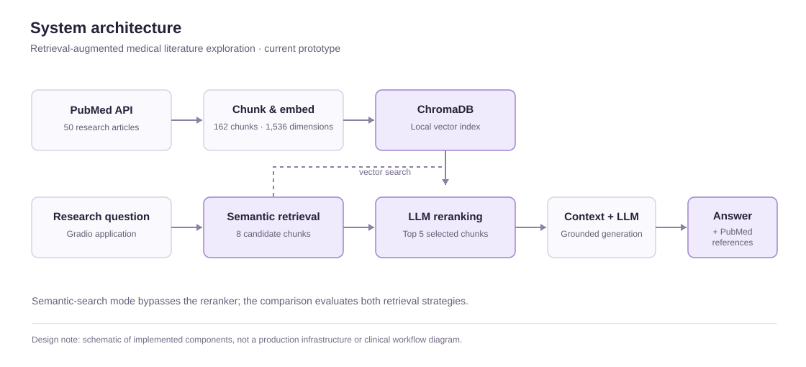

# MedEvidence AI

**Evidence-grounded medical literature assistant**  
*Research prototype · Python / LangChain / ChromaDB / OpenAI / Gradio*

MedEvidence AI is a retrieval-augmented generation (RAG) prototype for exploring biomedical literature through natural-language questions. It retrieves passages from a locally indexed collection of PubMed articles, optionally reranks candidate passages with a language model, and produces responses accompanied by source metadata.

**Project status:** Functional research prototype. Not clinically validated or intended for patient care.


*Actual application interface showing a research query and the LLM Reranking retrieval option.*

## Contents

- [Problem and scope](#problem-and-scope)
- [System architecture](#system-architecture)
- [Implementation](#implementation)
- [Evaluation](#evaluation)
- [Running the project](#running-the-project)
- [Repository layout](#repository-layout)
- [Limitations and responsible use](#limitations-and-responsible-use)
- [Roadmap](#roadmap)
- [References](#references)

## Problem and scope

Biomedical literature is extensive, and finding papers relevant to a specific research question can require repeated searches and manual review. MedEvidence AI explores whether a retrieval-first workflow can make a small, curated set of publications easier to navigate while preserving a path back to the underlying articles.

The current prototype supports:

- Natural-language questions against a PubMed-derived knowledge base.
- Embedding-based similarity search over article text chunks.
- An optional LLM reranking stage that reorders retrieved passages.
- Response generation conditioned on selected research context.
- Display of supporting article titles, PubMed identifiers (PMIDs), and source URLs.
- A separate dashboard for retrieval and preliminary answer-quality evaluation.

**Out of scope:** Patient-specific recommendations, diagnosis, treatment selection, clinical workflow integration, and medical-device claims.

## System architecture



The system has two connected workflows: offline research indexing and interactive question answering.

### Research indexing

1. **Acquisition:** Collect research articles using the PubMed API.
2. **Preparation:** Process article abstracts into text chunks while retaining article metadata.
3. **Representation:** Generate vector embeddings using `text-embedding-3-small`.
4. **Storage:** Store embeddings and associated metadata in a local ChromaDB collection.

### Question answering

1. Receive a research question from the Gradio interface.
2. Retrieve candidate chunks by embedding similarity.
3. In **LLM Reranking** mode, retrieve eight candidates and ask the model to reorder them by relevance; select the first five.
4. Assemble the selected passages into the generation prompt.
5. Generate a response with the language model and return available PubMed source information.

The application also supports a semantic-search workflow without the reranking stage. The reranker validates that its JSON response includes every candidate index exactly once; if validation fails, the original similarity ranking is retained.

## Implementation

### Knowledge base

| Property | Current configuration |
| --- | --- |
| Source | PubMed API |
| Retrieved articles | 50 |
| Indexed text chunks | 162 |
| Embedding model | `text-embedding-3-small` |
| Embedding dimensions | 1,536 |
| Vector store | ChromaDB (`medevidence_pubmed`) |
| Reranking candidates | 8 chunks |
| Reranked context | Top 5 chunks |

The corpus is a limited research sample, not a comprehensive or continuously updated medical evidence database.

### Technology

| Layer | Implementation |
| --- | --- |
| Language | Python |
| Orchestration | LangChain |
| Research acquisition | PubMed API |
| Embeddings | OpenAI `text-embedding-3-small` |
| Vector storage | ChromaDB |
| Generation and reranking | OpenAI `gpt-4o-mini` |
| Application interface | Gradio |
| Evaluation and reporting | Python, Pandas, Matplotlib, Gradio |

### Source traceability

Retrieved passages retain article-level metadata, including title, PMID, and URL. The interface exposes these references so a user can locate the original publication. **Source links are not, by themselves, proof that every generated claim is supported**; claim-level attribution and citation-faithfulness evaluation remain future work.

## Evaluation

The evaluation notebook compares semantic similarity retrieval with LLM reranking using **five LLM-generated research questions**, each paired with one expected PubMed article. Scores are computed against these candidate labels, not independently adjudicated clinical relevance judgments.

### Retrieval results

| Metric | Semantic search | LLM reranking | Change |
| --- | ---: | ---: | ---: |
| Hit Rate@5 | 1.0000 | 1.0000 | Unchanged |
| MRR@5 | 0.9000 | 1.0000 | +0.1000 absolute (+11.1% relative) |
| nDCG@5 | 0.9262 | 1.0000 | +0.0738 absolute (~8.0% relative) |

**Interpretation.** Both approaches returned the expected article within the evaluated top-five results for all five questions. In this small test, reranking moved the expected article to the first position for each question. These results support further experimentation; they do not demonstrate generalizable retrieval superiority or medical accuracy.

**Methodological qualifications:**

- Five questions are insufficient for robust statistical conclusions.
- Questions and expected PMIDs were generated from the same limited corpus, potentially favoring in-corpus retrieval.
- Each question has one expected article rather than graded judgments over multiple relevant papers.
- The current reranking comparison evaluates five selected chunks with duplicate PMIDs removed; it is not a complete top-five-*unique-article* evaluation.
- Answer quality was initially assessed on **one response** using an LLM judge; those scores are not clinical validation.
- End-to-end latency, model cost, citation faithfulness, and performance on unsupported questions have not yet been benchmarked.

### Evaluation dashboard

The dashboard reads `evaluation/evaluation_results.json` and presents three views:

1. **Retrieval Evaluation:** Baseline retrieval metrics.
2. **Answer Quality Evaluation:** Preliminary LLM-judged response scores.
3. **Retrieval Comparison:** Side-by-side semantic search and reranking metrics.

The **Refresh Evaluation Results** control reloads saved metrics. It does not rerun model evaluations.

## Running the project

### Prerequisites

- Python 3.x and a Jupyter-capable environment.
- An OpenAI API key with access to the configured models.
- Network access for PubMed ingestion and OpenAI requests.
- Project dependencies installed in the active environment.

> A pinned, tested `requirements.txt` and clean-environment installation procedure are not yet available. The following instructions describe the existing notebook workflow rather than a verified one-command deployment.

### Local workflow

1. Open `medevidence.ipynb` in Jupyter or VS Code.
2. Configure `OPENAI_API_KEY` through your local environment or a private `.env` file. Never commit credentials.
3. Run the ingestion, embedding, and indexing cells in order to build the local ChromaDB collection. The `chroma_db/` directory is intentionally excluded from version control.
4. Run the application cells to launch the Gradio research interface.
5. To inspect saved evaluation results, launch the dashboard from the repository root:

   ```bash
   python evaluator.py
   ```

6. To reproduce the experimental metrics, open `evaluation/evaluation.ipynb` and execute its cells with the required models and indexed corpus available. This will incur API usage.

The dashboard can display committed evaluation results without rerunning the model evaluations.

## Repository layout

```text
.
├── medevidence.ipynb                 # Research ingestion and RAG application
├── evaluator.py                     # Gradio evaluation dashboard
├── evaluation/
│   ├── evaluation.ipynb             # Retrieval and answer evaluation
│   └── evaluation_results.json      # Saved evaluation metrics
├── knowledge-base/
│   └── pubmed/
│       └── pubmed_articles.json     # Retrieved research metadata/text
├── static/
│   └── style.css                    # Application interface styling
├── assets/
│   ├── application-interface.png    # Actual application screenshot
│   └── system-architecture.svg      # Architecture diagram
├── .gitignore
└── README.md
```

The generated `chroma_db/` directory is local and is not required to be checked into Git.

## Limitations and responsible use

MedEvidence AI is designed for **literature exploration and technical experimentation**, not medical decision-making.

| Area | Current limitation |
| --- | --- |
| Coverage | Small, fixed PubMed-derived corpus; relevant studies may be absent. |
| Currency | No demonstrated continuous literature update or reindexing process. |
| Grounding | Retrieved context reduces reliance on model memory but does not eliminate hallucinations. |
| Citations | Article metadata is exposed; claim-level evidence verification is not implemented. |
| Validation | No expert clinical evaluation or independent relevance benchmark. |
| Privacy | No patient-data processing, privacy audit, or HIPAA compliance assessment has been demonstrated. |
| Operations | No production deployment, access controls, monitoring, or reliability guarantees have been established. |

**Do not use this software for diagnosis, treatment, medication decisions, emergency triage, or other patient-care decisions.** Do not submit identifiable patient information or protected health information to the prototype. Verify important findings against original publications and appropriate clinical guidance.

Regulatory classification depends on the intended use and functionality of a software product. This repository does not claim FDA clearance, medical-device exemption, or regulatory compliance.

## Roadmap

Prioritized follow-up work:

1. **Evaluation rigor:** Larger question set, independent relevance labels, article-level deduplication, confidence intervals, and error analysis.
2. **Evidence quality:** Claim-to-source attribution, unsupported-claim detection, and explicit insufficient-evidence responses.
3. **Reproducibility:** Pinned dependencies, configuration template, deterministic test fixtures, and a clean-install smoke test.
4. **Operational measurements:** Retrieval and generation latency, token usage, and per-query cost.
5. **Corpus management:** Search strategy documentation, article selection criteria, update cadence, and versioned index metadata.

## References

**Research and platform documentation**

- [PubMed / NCBI](https://pubmed.ncbi.nlm.nih.gov/)
- [NCBI E-utilities](https://www.ncbi.nlm.nih.gov/books/NBK25501/)
- [LangChain documentation](https://docs.langchain.com/)
- [Chroma documentation](https://docs.trychroma.com/)

**Responsible development context**

- [NIST AI Risk Management Framework](https://www.nist.gov/itl/ai-risk-management-framework)
- [NIST Generative AI Profile](https://www.nist.gov/publications/artificial-intelligence-risk-management-framework-generative-artificial-intelligence)
- [FDA: Clinical Decision Support Software Guidance (2026)](https://www.fda.gov/regulatory-information/search-fda-guidance-documents/clinical-decision-support-software)

These references inform documentation and future development considerations. They do not indicate endorsement, certification, or regulatory approval of MedEvidence AI.
